<p align="center">
  
</p>

<p align="center">
  The Android x86-64 version of Roblox, running natively on Windows desktops.
</p>

## Install

Download `Elixir.exe` from the [latest release](https://github.com/angie-74/Elixir/releases/latest) and run it.
It installs itself, and Roblox is installed the first time you launch it.

Elixir needs 64-bit Windows 10 or 11 and a graphics card with Vulkan.

## Build

Elixir builds with Visual Studio 2022 Build Tools, CMake, Ninja and the Android NDK:

```powershell
git clone --recursive https://github.com/angie-74/Elixir.git
cd Elixir
powershell -ExecutionPolicy Bypass -File tools\build.ps1 -Guest -Config Release
```

The program is `build\windows\Elixir.exe`.

## Credits

Elixir is built on [Mocktail](https://github.com/komaruworld/mocktail), and its launcher follows
[Fishstrap](https://github.com/fishstrap/fishstrap). The Credits and Licenses tabs in Elixir list everything else.

## License

Elixir is licensed under the [Apache License 2.0](LICENSE). Third-party code keeps its own licenses, listed in
[THIRD_PARTY_NOTICES.txt](THIRD_PARTY_NOTICES.txt).

Elixir is not affiliated with Roblox Corporation.
